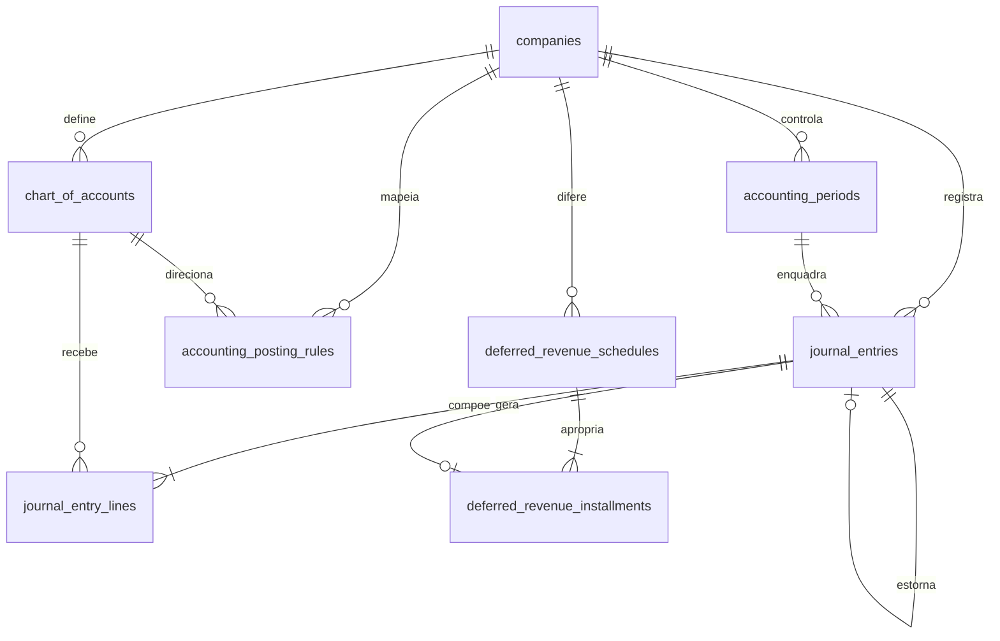

# Módulo de Contabilidade — Especificação Técnica e Normativa (PFM)

> **Documentos relacionados (leitura obrigatória):**
> - [SECURITY.md](./SECURITY.md) — Padrões obrigatórios OWASP aplicados à stack (em especial **§ 13 — Financeiro, Contabilidade, Pagamentos e Fiscal**)
> - [MODULO_FINANCEIRO.md](./MODULO_FINANCEIRO.md) — Contas a Pagar/Receber, Fluxo de Caixa e eventos financeiros que alimentam a contabilidade
> - [IMPLEMENTACAO_NFSE_ADN.md](./IMPLEMENTACAO_NFSE_ADN.md) — Integração fiscal futura com Padrão Nacional NFS-e

**Versão:** 1.0 (`2026-11-26`)
**Stack alvo:** Bun 1.x + TypeScript 5.9 + Fastify v5 + Zod 4 + Drizzle ORM + PostgreSQL 16 + React 19 (Vite)

---

## 1. Objetivo, Posicionamento Legal e Limites Inegociáveis (CFC / CRC)

O **Módulo de Contabilidade do PFM** nasce com um propósito claro: oferecer **Pré-Contabilidade, Contabilidade Gerencial e Escrituração Auxiliar em Partidas Dobradas** para PMEs prestadoras de serviços e operações SaaS, reduzindo o atrito entre a operação diária da empresa e o escritório contábil parceiro.

> [!WARNING]
> **Limite Legal Crítico — Prerrogativa Profissional (Decreto-Lei nº 9.295/1946 e CFC):**
> No Brasil, a escrituração contábil oficial, a apuração tributária vinculante, a assinatura de **Balanço Patrimonial / DRE societários** e a transmissão de obrigações acessórias federais (**SPED ECD, ECF, EFD-Contribuições, DEFIS, PGDAS-D**) são prerrogativas legais **exclusivas de Contador ou Técnico em Contabilidade regularmente registrado no Conselho Regional de Contabilidade (CRC)**.
>
> **O PFM não substitui o contador nem assume responsabilidade técnica de escritório contábil.**

### 1.1 O que o PFM Faz vs. O que Fica Fora do Sistema
- **O que o PFM faz (dentro das nossas limitações):**
  - Mantém Plano de Contas configurável baseado na **NBC TG 1002** (Microentidades) e **NBC TG 1001** (Pequenas Empresas).
  - Registra lançamentos em **partidas dobradas** (`Débito = Crédito`) com histórico padronizado, numeração sequencial e vínculo documental (`nf`, `financial_settlements`, `services`) em modelo **imutável / *append-only*** (ITG 2000).
  - Controla abertura e **fechamento mensal de competências** (`accounting_periods`).
  - Gera automaticamente **Livro Diário auxiliar, Livro Razão, Balancete de Verificação, DRE Gerencial/Societária preliminar e Balanço Patrimonial preliminar**.
  - Gera o **"Pacote Mensal do Contador"** (exportação estruturada + CSV sanitizado + PDFs das NFs armazenadas em `archives/{companyId}/`) para importação e validação no sistema do escritório contábil.
  - Monitora de forma **estimativa** a Receita Diferida (CPC 47 para assinaturas anuais/antecipadas) e o **Fator R do Simples Nacional** (Fase 3).
- **O que o PFM NÃO faz:**
  - Não assina demonstrações contábeis com CRC nem gera arquivo SPED ECD validado/assinado no PVA da Receita Federal na Fase 1/2.
  - Não apura nem transmite guias oficiais DAS, DARF, GPS, DCTFWeb, eSocial ou EFD-Reinf.
  - Todo relatório emitido pelo módulo deve exibir o aviso institucional: *"Demonstrativo gerencial/auxiliar para conferência contábil. Não substitui escrituração oficial assinada por profissional habilitado no CRC."*

---

## 2. Arcabouço Normativo, Doutrinário e Classificação das Referências

### 2.1 Normas Brasileiras e Doutrina Aplicáveis ao PFM

| Norma / Obra | Escopo Oficial | Como Orienta o Design no PFM |
| --- | --- | --- |
| **Lei nº 6.404/1976** (alterada pelas **Leis nº 11.638/2007** e **nº 11.941/2009**) | Lei das Sociedades por Ações e convergência brasileira às normas internacionais (IFRS/CPC) | Define a estrutura clássica das contas patrimoniais e de resultado (Ativo Circulante/Não Circulante, Passivo, PL e DRE em regime de competência). |
| **NBC TG 1002** (CFC — substituta da antiga ITG 1000) | Contabilidade para **Microentidades** (receita bruta anual até **R$ 4,8 milhões**) | **Padrão default** do Plano de Contas inicial do PFM: modelo simplificado de Balanço Patrimonial, DRE e Notas Explicativas, mantendo partidas dobradas obrigatórias. |
| **NBC TG 1001** (CFC) | Contabilidade para **Pequenas Empresas** (receita bruta anual acima de R$ 4,8M até **R$ 78 milhões**) | Suportada via extensão do Plano de Contas (adição de contas analíticas de provisões, intangíveis, DFC completa e DMPL). |
| **ITG 2000 (R1)** (CFC) | **Escrituração Contábil** formal aplicável a todas as entidades | Impõe os requisitos de software implementados no banco: idioma e moeda nacionais (BRL), ordem cronológica por data/número, soma `Débitos = Créditos`, histórico descritivo claro, lastro em documento idôneo e **proibição de exclusão/rasura** (correção apenas por estorno, transferência ou complementação). |
| **CPC 47 / IFRS 15 / ASC 606** | Receita de Contrato com Cliente (modelo em 5 etapas) | Base para **Receita Diferida (*Deferred Revenue*)** em contratos de serviço contínuo e assinaturas SaaS pagas antecipadamente (Seção 3). |
| **Manual de Contabilidade Societária (FIPECAFI)** — Eliseu Martins, Sérgio de Iudícibus, Ariovaldo dos Santos e Ernesto Rubens Gelbcke | Referência doutrinária máxima da contabilidade brasileira ("Bíblia dos Contadores") | Fundamenta classificação de contas, natureza devedora/credora, distinção entre custo do serviço prestado (CSP) e despesa operacional, e regime de competência. |
| **Manual de Contabilidade Gerencial** — Osni Hoss | Execução prática passo a passo voltada à tomada de decisão | Fundamenta centros de custo, análise de margem de contribuição e ligação entre relatórios contábeis e gestão financeira. |

### 2.2 Triagem Completa dos Links de Referência Consultados

| Fonte / URL | Classificação no PFM |
| --- | --- |
| [CFC — Legislação e Leis](https://cfc.org.br/legislacao/leis/) | **Aplicável (Base Legal):** Marco regulatório da profissão contábil (DL 9.295/46) e competência do CFC/CRCs. |
| [Gov.br — NBC TG 1001 (Pequenas Empresas)](https://www.gov.br/participamaisbrasil/nbc-tg-1001-contabilidade-para-pequenas-empresas) | **Aplicável:** Faixas de faturamento (NBC TG 1002 até R$ 4,8M; NBC TG 1001 de R$ 4,8M a R$ 78M) e estrutura das demonstrações contábeis. |
| [Jornal Contábil — Principais Normas e Leis](https://jornalcontabil.com.br/noticia/principais-normas-e-leis-que-regulam-a-atividade-contabil-no-brasil/) | **Aplicável:** Panorama das NBCs profissionais e técnicas (ITG 2000, NBC TG 1000/1001/1002). |
| [Irko — Normas Brasileiras de Contabilidade](https://site.irko.com.br/blog/normas-brasileiras-de-contabilidade-conheca-a-principais/) & [Strong — Normas Contábeis](https://strong.com.br/glossario/quais-sao-as-normas-contabeis-mais-importantes/) | **Aplicável:** Hierarquia entre CPCs completos, PMEs (NBC TG 1000/1001/1002) e obrigações de escrituração. |
| [Revista de Contabilidade e Gestão (CGG) — Artigo 65](https://www.revistacgg.org/index.php/contabil/article/view/65) | **Aplicável:** Fundamentos acadêmicos e evolução normativa contábil. |
| [ContabNet — Contabilidade SaaS](https://contabnet.com.br/blog/contabilidade-para-empresa-saas/), [Moreira Mendes — Contabilidade Estratégica SaaS](https://moreiramendes.com.br/blog/saas-e-tecnologia-desmistificando-a-contabilidade-estrategica), [Stripe — SaaS Accounting 101](https://stripe.com/br/resources/more/saas-accounting-101), [NetSuite](https://www.netsuite.com/portal/resource/articles/accounting/saas-accounting.shtml), [G-Squared CFO](http://gsquaredcfo.com/the-ultimate-guide-to-saas-business-accounting) | **Aplicável:** Competência vs. Caixa em SaaS, Receita Diferida (ASC 606 / CPC 47), Fator R no Simples Nacional (Anexo V → Anexo III), reconhecimento mensal e separação entre faturamento e receita reconhecida. |
| Referências sobre o Manual FIPECAFI ([CRC-DF](https://crcdf.org.br/5-livros-de-contabilidade-que-todo-contador-deveria-ler/), [FEA-USP](http://www.fea.usp.br/fea/noticias/biblia-do-contador-produzida-pela-fea-tem-edicao-especial.html), [BLB](https://blbescoladenegocios.com.br/blog/livros-profissional-contabilidade-deveria-ler/), [Valid](https://validcertificadora.com.br/blogs/contabilidade/9-livros-que-todo-contabilista-deveria-ler?srsltid=AYCX9vKGCm765-IT5ogAycwQf9O1RdfWGQn91zNuApPIFoC6fTrhV2j8)) | **Aplicável:** Fundamentação teórica do plano de contas, partidas dobradas e convergência Lei nº 6.404/76 → 11.638/07 → 11.941/09. |
| [MPU — Normas Contabilidade Pública](https://www.mpu.mp.br/legislacao/contabilidade/normas-aplicaveis-a-contabilidade-publica) & [Betha — Leis Contabilidade Pública](https://www.betha.com.br/blog/leis-norteiam-contabilidade-publica-brasileira/) | **Fora de Escopo:** Regem **Contabilidade Aplicada ao Setor Público** (NBC TSP, MCASP, Lei nº 4.320/64, LRF, PCASP). O PFM atende empresas **privadas** regidas pelo Código Civil, Lei das S.A. e NBC TG. |

---

## 3. Regime de Competência vs. Caixa, Receita Diferida (CPC 47) e Monitor do Fator R

### 3.1 Por que o PFM Separa Financeiro (Caixa) de Contabilidade (Competência)
Uma falha comum em sistemas simples é considerar que "entrou dinheiro no banco = receita do mês". Isso distorce o resultado real da empresa e viola os princípios contábeis brasileiros:
- **Regime de Caixa (`MODULO_FINANCEIRO.md`):** Registra quando o dinheiro entra ou sai da conta (`settled_at`). Mede **liquidez**.
- **Regime de Competência (`MODULO_CONTABILIDADE.md`):** Registra receitas e despesas no mês em que o serviço foi prestado ou o recurso consumido (`competence_date` / `competence_month`), independentemente do recebimento ou pagamento. Mede **lucratividade real**.

### 3.2 Modelo Prático de Receita Diferida (CPC 47 / IFRS 15 — Fase 3)
Seguindo as 5 etapas do **CPC 47** (identificar contrato → identificar obrigações de desempenho → determinar preço → alocar preço → reconhecer receita conforme a obrigação é satisfeita ao longo do tempo):

**Exemplo numérico:** Cliente assina plano anual de software/serviço em **01/01** por **R$ 1.200,00** pagos à vista via PIX:
1. **No recebimento (01/01):**
   - Financeiro (Caixa): `+R$ 1.200,00` na conta bancária.
   - Contabilidade: **NÃO** reconhece R$ 1.200,00 como receita de janeiro. Lança no Passivo:
     - `D` `1.1.01.002 Bancos Conta Movimento` — **R$ 1.200,00**
     - `C` `2.1.04.001 Receita Diferida (Adiantamentos/Assinaturas)` — **R$ 1.200,00** *(Passivo Circulante — obrigação de prestar o serviço pelos próximos 12 meses)*
2. **Apropriação mensal (competência 01/2026 a 12/2026 — R$ 100,00/mês):**
   - A cada fechamento/virada de mês em `deferred_revenue_installments`:
     - `D` `2.1.04.001 Receita Diferida` — **R$ 100,00**
     - `C` `3.1.01.002 Receita de Assinaturas / Mensalidades` — **R$ 100,00** *(DRE do mês)*
   - Dessa forma, cada mês reflete exatamente R$ 100,00 de receita auferida e o Passivo zera ao final dos 12 meses.

### 3.3 Monitor Gerencial do Fator R (Simples Nacional — Fase 3)
Para empresas de tecnologia/serviços enquadradas no Simples Nacional, a atividade pode pagar imposto pelo **Anexo V** (alíquota inicial ~15,5%) ou migrar para o **Anexo III** (alíquota inicial ~6%) quando o **Fator R ≥ 28%**:

$$\text{Fator R} = \frac{\text{Folha de Salários + Pró-labore + Encargos (últimos 12 meses)}}{\text{Receita Bruta Total dos últimos 12 meses (RBT12)}}$$

- **Como o PFM implementa de forma realista:** Usando os saldos acumulados nos últimos 12 meses das contas contábeis marcadas como `fator_r_payroll` (pró-labore, salários, INSS patronal/FGTS) divididos pelas contas de receita bruta (`3.1.01.*`), o dashboard exibe um **termômetro indicativo** (ex.: `"Fator R estimado: 26,4% — faltam ~R$ 1.850 em pró-labore/folha para atingir 28%"`).
- **Aviso obrigatório:** O indicador é **estimativo** e depende de todos os lançamentos de folha e faturamento estarem registrados no PFM; a apuração oficial do PGDAS-D cabe exclusivamente ao contador.

---

## 4. Plano de Contas Padrão (Seed Inicial NBC TG 1002 / PME & SaaS)

Ao ativar o módulo contábil para uma empresa (`company_id`), o sistema cria um **Plano de Contas inicial enxuto** (customizável pelo `company_admin` ou `accountant`, protegendo contas estruturais do sistema):

| Código | Descrição da Conta | Tipo | Natureza | Analítica? | Uso no PFM |
| --- | --- | --- | --- | --- | --- |
| `1` | **ATIVO** | `asset` | `debit` | Não | Grupo raiz |
| `1.1` | Ativo Circulante | `asset` | `debit` | Não | — |
| `1.1.01` | Caixa e Equivalentes de Caixa | `asset` | `debit` | Não | — |
| `1.1.01.001` | Caixa Geral | `asset` | `debit` | **Sim** | Contas `type = cash` |
| `1.1.01.002` | Bancos Conta Movimento | `asset` | `debit` | **Sim** | Contas `checking/savings` |
| `1.1.01.003` | Carteiras / Gateways de Pagamento a Liquidar | `asset` | `debit` | **Sim** | Contas `gateway` |
| `1.1.02` | Créditos a Receber | `asset` | `debit` | Não | — |
| `1.1.02.001` | Clientes a Receber (Serviços / NFs) | `asset` | `debit` | **Sim** | Contrapartida de `receivable` |
| `1.1.03` | Créditos com Partes Relacionadas (Matriz/Filiais) | `asset` | `debit` | **Sim** | Transferências *intercompany* |
| `2` | **PASSIVO E PATRIMÔNIO LÍQUIDO** | `liability` / `equity` | `credit` | Não | Grupo raiz |
| `2.1` | Passivo Circulante | `liability` | `credit` | Não | — |
| `2.1.01.001` | Fornecedores a Pagar | `liability` | `credit` | **Sim** | Contrapartida de `payable` |
| `2.1.02.001` | Salários e Pró-Labore a Pagar | `liability` | `credit` | **Sim** | Folha / Fator R |
| `2.1.03.001` | Impostos e Encargos a Recolher (ISS, DAS, INSS) | `liability` | `credit` | **Sim** | Obrigações tributárias |
| `2.1.04.001` | **Receita Diferida (Contratos Antecipados CPC 47)** | `liability` | `credit` | **Sim** | Assinaturas anuais/antecipadas |
| `2.1.05.001` | Débitos com Partes Relacionadas (Matriz/Filiais) | `liability` | `credit` | **Sim** | Transferências *intercompany* |
| `2.3` | Patrimônio Líquido | `equity` | `credit` | Não | — |
| `2.3.01.001` | Capital Social | `equity` | `credit` | **Sim** | Aporte dos sócios |
| `2.3.02.001` | Lucros ou Prejuízos Acumulados | `equity` | `credit` | **Sim** | Apuração de resultado |
| `3` | **RECEITAS** | `revenue` | `credit` | Não | Grupo raiz DRE |
| `3.1.01.001` | Receita de Prestação de Serviços | `revenue` | `credit` | **Sim** | Serviços / NFs pontuais |
| `3.1.01.002` | Receita de Assinaturas / SaaS | `revenue` | `credit` | **Sim** | Contratos recorrentes |
| `3.1.02.001` | (-) Impostos sobre Serviços / Deduções (ISS, Simples) | `revenue` *(dedutiva)* | **`debit`** | **Sim** | Dedução da receita bruta |
| `3.2.01.001` | Receitas Financeiras (Juros/Rendimentos) | `revenue` | `credit` | **Sim** | Juros recebidos em atrasos |
| `4` | **CUSTOS E DESPESAS** | `cost` / `expense` | `debit` | Não | Grupo raiz DRE |
| `4.1.01.001` | Custo dos Serviços Prestados (Infra/Cloud/Terceiros) | `cost` | `debit` | **Sim** | CSP / COGS |
| `4.2.01.001` | Despesas com Pessoal e Pró-Labore *(tag Fator R)* | `expense` | `debit` | **Sim** | Despesa administrativa/pessoal |
| `4.2.02.001` | Despesas Administrativas e Ocupação | `expense` | `debit` | **Sim** | Aluguel, internet, contabilidade |
| `4.2.03.001` | Despesas Comerciais e Marketing | `expense` | `debit` | **Sim** | Tráfego, vendas, comissões |
| `4.3.01.001` | Despesas Financeiras e Taxas de Gateway | `expense` | `debit` | **Sim** | Taxas PIX/cartão/boleto, multas |

> **Regra ITG 2000:** Somente contas **analíticas** (`is_analytical = true`) recebem lançamentos contábeis. Contas sintéticas (`1`, `1.1`, `1.1.01`) exibem apenas saldos consolidados de suas filhas.

---

## 5. Modelagem de Dados Contábil (PostgreSQL + Drizzle ORM)

Assim como no Módulo Financeiro, **todos os valores contábeis são armazenados em centavos inteiros (`bigint`)**, garantindo diferença exatamente igual a `0` entre soma de débitos e soma de créditos (`SECURITY.md` § 13.1).

### 5.1 Especificação das Tabelas

1. **`chart_of_accounts`** (Plano de Contas por empresa)
   - `id` (UUID v7 PK), `company_id` (FK `companies.id` NOT NULL)
   - `parent_id` (UUID self-reference nullable)
   - `code` (varchar(32) NOT NULL — único por `company_id`), `name` (text NOT NULL)
   - `account_type` (`'asset' | 'liability' | 'equity' | 'revenue' | 'cost' | 'expense'` NOT NULL)
   - `normal_balance` (`'debit' | 'credit'` NOT NULL)
   - `is_analytical` (`boolean` NOT NULL default `true`)
   - `is_system` (`boolean` NOT NULL default `false`)
   - `fator_r_payroll` (`boolean` NOT NULL default `false` — marca contas consideradas no numerador do Fator R)
   - `sped_ref_code` (varchar(32) nullable — campo opcional na Fase 3 para DE-PARA com Plano Referencial RFB/ECD)
   - `active` (`boolean` default `true`), `created_at`, `updated_at`

2. **`accounting_periods`** (Controle de Competência e Travamento Mensal)
   - `id` (UUID v7 PK), `company_id` (FK `companies.id` NOT NULL)
   - `year_month` (`char(7)` NOT NULL — formato `'YYYY-MM'`, único por `company_id`)
   - `start_date` (`date` NOT NULL), `end_date` (`date` NOT NULL)
   - `status` (`'open' | 'closing' | 'closed'` NOT NULL default `'open'`)
   - `closed_by` (FK `users.id` nullable), `closed_at` (`timestamp` nullable)
   - `reopened_by` (FK `users.id` nullable), `reopened_at` (`timestamp` nullable), `reopen_reason` (text nullable)
   - **Regra de integridade:** Qualquer tentativa de criar, confirmar ou estornar lançamento com `competence_month` em período `closed` é rejeitada com `409 Conflict` (tanto na camada de UseCase quanto via validação transacional/trigger SQL).

3. **`journal_entries`** (Cabeçalho do Lançamento — Livro Diário / ITG 2000)
   - `id` (UUID v7 PK), `company_id` (FK `companies.id` NOT NULL)
   - `period_id` (FK `accounting_periods.id` NOT NULL)
   - `entry_number` (`bigint` NOT NULL — sequencial contínuo por `(company_id, fiscal_year)` quando `status = 'posted'`)
   - `fiscal_year` (`integer` NOT NULL)
   - `entry_date` (`date` NOT NULL — data do lançamento), `competence_month` (`char(7)` NOT NULL)
   - `description` (text NOT NULL — histórico contábil padronizado ITG 2000)
   - `status` (`'draft' | 'posted' | 'reversed'` NOT NULL)
   - `reversed_entry_id` (UUID self-reference nullable — preenchido no lançamento de estorno)
   - `source_type` (`'manual' | 'financial_entry' | 'financial_settlement' | 'financial_transfer' | 'nf' | 'deferred_revenue' | 'period_closing'` NOT NULL)
   - `source_id` (UUID nullable — ID do registro de origem para rastreabilidade 1-clique)
   - `is_intercompany` (`boolean` NOT NULL default `false`)
   - `idempotency_key` (varchar(128) NOT NULL)
   - `prev_hash` (`char(64)` nullable), `entry_hash` (`char(64)` nullable — opcional na Fase 3: hash SHA-256 canônico encadeado por empresa para prova de integridade)
   - `created_by` (FK `users.id` NOT NULL), `posted_by` (FK `users.id` nullable), `posted_at` (`timestamp` nullable), `created_at` (`timestamp` NOT NULL default `now()`)
   - **Regra de imutabilidade:** Lançamento em `status = 'posted'` **nunca** pode ter `entry_date`, `competence_month`, `description` ou linhas alteradas nem ser apagado (`DELETE`). A única transição permitida a partir de `posted` é a geração de um novo lançamento de estorno (`reversed_entry_id = original.id`), marcando `original.status = 'reversed'` apenas como flag de estado.

4. **`journal_entry_lines`** (Partidas Dobradas — Razão)
   - `id` (UUID v7 PK), `journal_entry_id` (FK `journal_entries.id` NOT NULL)
   - `company_id` (FK `companies.id` NOT NULL — redundância intencional para índice multi-tenant rápido no Razão)
   - `account_id` (FK `chart_of_accounts.id` NOT NULL — validado `is_analytical = true` e mesmo `company_id`)
   - `debit_cents` (`bigint` NOT NULL default `0`)
   - `credit_cents` (`bigint` NOT NULL default `0`)
   - `cost_center_id` (UUID nullable), `memo` (text nullable)
   - **Constraints obrigatórias (SQL + Zod + UseCase):**
     - `CHECK ((debit_cents > 0 AND credit_cents = 0) OR (credit_cents > 0 AND debit_cents = 0))`
     - Validação transacional no servidor: mínimo 2 linhas, `SUM(debit_cents) === SUM(credit_cents) > 0`.

5. **`accounting_posting_rules`** (Mapeamento Financeiro → Contabilidade — Fase 2)
   - `id` (UUID v7 PK), `company_id` (FK `companies.id` NOT NULL)
   - `financial_category_id` (UUID nullable) ou `financial_account_id` (UUID nullable)
   - `event_type` (`'receivable_accrual' | 'receivable_settlement' | 'payable_accrual' | 'payable_settlement' | 'gateway_fee' | 'interest_income' | 'interest_expense' | 'intercompany_transfer'`)
   - `debit_account_id` (FK `chart_of_accounts.id` NOT NULL)
   - `credit_account_id` (FK `chart_of_accounts.id` NOT NULL)

6. **`deferred_revenue_schedules`** e **`deferred_revenue_installments`** (Fase 3 — CPC 47)
   - `deferred_revenue_schedules`: `id`, `company_id`, `source_entry_id` (título/contrato), `total_amount_cents`, `months_count`, `recognized_amount_cents`, `liability_account_id` (`2.1.04.001`), `revenue_account_id` (`3.1.01.002`), `start_month`, `status` (`'active' | 'completed' | 'cancelled'`).
   - `deferred_revenue_installments`: `id`, `schedule_id`, `competence_month`, `amount_cents`, `status` (`'scheduled' | 'recognized' | 'cancelled'`), `journal_entry_id` (FK `journal_entries.id` nullable).

---

## 6. Motor de Contabilização Automática (Ponte Financeiro/NF → Contabilidade)

Para evitar digitação dupla pelo usuário, cada evento confirmado no Módulo Financeiro gera automaticamente um `journal_entry` em status `posted` dentro da **mesma transação PostgreSQL**, respeitando `accounting_posting_rules`:

| Evento no Financeiro / NF | Débito (`D`) | Crédito (`C`) | Observação |
| --- | --- | --- | --- |
| **1. Título a Receber criado/confirmado (Serviço/NF pontual)** | `1.1.02.001 Clientes a Receber` | `3.1.01.001 Receita de Serviços` | Competência = `entry.competence_date` |
| **2. Recebimento de Título (Baixa com taxa PSP + juros)** | `1.1.01.002 Bancos` (líquido) `4.3.01.001 Taxas Gateway` (taxa) | `1.1.02.001 Clientes a Receber` (principal) `3.2.01.001 Receitas Financeiras` (juros) | Partida composta (4 linhas); soma D = soma C garantida em `BigInt` |
| **3. Título a Pagar criado/confirmado (Despesa/Custo)** | `4.2.02.001 Despesas Admin` (ou categoria mapeada) | `2.1.01.001 Fornecedores a Pagar` | Competência no mês do fato gerador |
| **4. Pagamento de Título (Baixa com multa/juros)** | `2.1.01.001 Fornecedores a Pagar` (principal) `4.3.01.001 Despesas Financeiras` (juros/multa) | `1.1.01.002 Bancos` (total pago) | Baixa atualiza saldo bancário + Razão |
| **5. Contrato Anual Antecipado (Fase 3 — CPC 47)** | `1.1.02.001 Clientes a Receber` | `2.1.04.001 Receita Diferida` | Passivo diferido; apropriação mensal `D 2.1.04.001 / C 3.1.01.002` |
| **6. Transferência Matriz ↔ Filial (*Intercompany*)** | Na recebedora: `1.1.01.002 Bancos` Na remetente: `1.1.03 Créditos Partes Rel.` | Na recebedora: `2.1.05 Débitos Partes Rel.` Na remetente: `1.1.01.002 Bancos` | Lançamentos marcados com `is_intercompany = true` para eliminação na DRE/Balanço Consolidado |
| **7. Estorno de Baixa / Cancelamento** | Inverte exatamente D ↔ C do lançamento original | Inverte exatamente D ↔ C do lançamento original | Se período original estiver `closed`, o estorno ocorre no primeiro período `open` subsequente com referência explícita |

---

## 7. Relatórios Contábeis e "Pacote Mensal do Contador"

### 7.1 Demonstrativos Gerados pelo PFM
1. **Livro Diário Auxiliar:** Listagem cronológica por `entry_number` e `entry_date`, mostrando contas debitadas, creditadas, histórico e referência ao documento (`nf.number_nf` / `service_id`).
2. **Livro Razão Analítico:** Movimentação detalhada de uma conta específica em um intervalo de datas, com **saldo anterior**, débitos, créditos e **saldo corrente acumulado**.
3. **Balancete de Verificação:** Todas as contas com saldo anterior, movimento a débito, movimento a crédito e saldo final no período; exibe conferência matemática obrigatória (`Total Débitos === Total Créditos`).
4. **DRE Preliminar (Estrutura NBC TG 1002 / 1001):**
   - Receita Bruta de Serviços e Assinaturas (`3.1.01.*`)
   - `(-)` Deduções / Impostos sobre Faturamento (`3.1.02.*`)
   - `(=)` **Receita Líquida**
   - `(-)` Custos dos Serviços Prestados (`4.1.*`)
   - `(=)` **Lucro Bruto**
   - `(-)` Despesas Operacionais (`4.2.*` — Pessoal, Administrativas, Comerciais)
   - `(+/-)` Resultado Financeiro Líquido (`3.2.* - 4.3.*`)
   - `(=)` **Resultado Líquido do Exercício (antes do IR/CSLL oficial)**
5. **Balanço Patrimonial Preliminar:** Fotografia acumulada até a data-base de Ativo (`1.*`) vs. Passivo + Patrimônio Líquido + Resultado Apurado do Período (`2.* + Resultado`), validando `Ativo === Passivo + PL`.
6. **Visão Consolidada Matriz + Filiais (`x-view-scope=consolidated`):** Agrega os saldos das empresas em `accessibleCompanyIds`, ocultando saldos e lançamentos marcados com `is_intercompany = true` conforme `SECURITY.md` § 13.6.

### 7.2 Pacote Mensal do Contador (Exportação Prática)
Como escritórios contábeis usam softwares variados (Domínio, Alterdata, Fortes, Questor, ContaAzul), a forma mais realista de integração sem acoplamento proprietário é disponibilizar **1 endpoint/botão de exportação mensal** contendo:
- `01_plano_de_contas.csv` (com `code`, `name`, `account_type`, `sped_ref_code`)
- `02_lancamentos_diario_YYYY-MM.csv` (partidas dobradas no padrão universal data;conta_debito;conta_credito;valor;historico;documento)
- `03_balancete_YYYY-MM.csv` e `04_dre_YYYY-MM.csv`
- `05_resumo_consolidado.json` (metadados da competência, totais em centavos e hash de conferência)
- Pasta `notas_fiscais/` com os PDFs armazenados em `archives/{companyId}/` referentes à competência, respeitando validação rigorosa de Path Traversal (`src/lib/archivePath.ts`).

---

## 8. Contratos de API, RBAC (`accountant`), Segurança e Retenção LGPD

### 8.1 Recomendação de Papel Dedicado (`accountant`)
Conforme `SECURITY.md` § 13.6, recomenda-se adicionar o papel `accountant` em `roles` (`src/database/seed.ts`):
- **Permissões de `accountant`:** Acesso total de leitura ao Razão, Diário, Balancete, DRE, Balanço, NFs (`GET /nf/:id/file`) e exportação do Pacote Mensal; permissão de lançar ajustes contábeis manuais, editar `sped_ref_code` e executar **fechamento de competência (`close`)**.
- **Restrições de `accountant`:** Não gerencia usuários (`company_admin`) e não executa transferências/pagamentos bancários no módulo financeiro; `colaborator` permanece **100% bloqueado (403)**.

### 8.2 Endpoints Planejados (`/accounting/*`)

| Método e Rota | Descrição | Papéis Permitidos | Controles Obrigatórios (`SECURITY.md`) |
| --- | --- | --- | --- |
| `GET/POST/PATCH /accounting/accounts` | Plano de contas da empresa | Leitura: `company_admin, accountant, finance, manager, observer` Escrita: `company_admin, accountant` | Bloqueia conversão analítica→sintética se já houver lançamentos |
| `GET /accounting/periods` | Listar competências (`YYYY-MM`) | Todos acima exceto `colaborator` | Isolado por `accessibleCompanyIds` |
| `POST /accounting/periods/:ym/close` | Fechar competência mensal | `company_admin, accountant` | Verifica se há rascunhos pendentes; grava `audit_logs` |
| `POST /accounting/periods/:ym/reopen` | Reabrir competência fechada | `company_admin` (ou `accountant` com alçada) | **Obrigatório:** justificativa mínima (20+ chars) + reconfirmação de senha/OTP + `audit_logs` |
| `GET/POST /accounting/journal-entries` | Listar Diário e criar lançamento manual | Leitura: todos autorizados Escrita: `company_admin, accountant` | `Idempotency-Key` + `db.transaction` + `SUM(debit) === SUM(credit) > 0` + período `open` |
| `POST /accounting/journal-entries/:id/reverse` | Estornar lançamento confirmado | `company_admin, accountant` | Gera novo lançamento inverso *append-only*; proibido alterar o original |
| `GET /accounting/reports/ledger` | Livro Razão por conta e período | Leitura autorizada | Paginação estrita + janela máxima de 366 dias |
| `GET /accounting/reports/trial-balance` | Balancete de Verificação | Leitura autorizada | Valida integridade `Débitos === Créditos` na resposta |
| `GET /accounting/reports/dre` e `/balance-sheet` | DRE e Balanço Preliminares | Leitura autorizada | Inclui disclaimer legal automático no payload/PDF/CSV |
| `GET /accounting/exports/monthly-package` | Pacote Mensal do Contador (CSV/ZIP) | `company_admin, accountant, finance` | CSV neutralizado contra formula injection (`=`, `+`, `-`, `@`, `\t`, `\r`); path traversal safe em `archives/` |

### 8.3 Segurança, Imutabilidade e Retenção Legal vs. LGPD
1. **Imutabilidade e Anti-Adulteração:** Nenhuma rota de API expõe `UPDATE` ou `DELETE` para linhas de `journal_entries` em status `posted` ou `journal_entry_lines`. Na Fase 3, cada novo lançamento calcula `entry_hash = SHA256(prev_hash || canonical_json_lines)` por empresa, permitindo verificar matematicamente que nenhum registro histórico foi adulterado diretamente no banco.
2. **Prevenção de Formula Injection:** Todas as exportações CSV do Diário, Razão, Balancete e DRE passam por função utilitária compartilhada que neutraliza células iniciadas por `=`, `+`, `-`, `@`, `\t` ou `\r`.
3. **Retenção Legal (5 a 10 anos) vs. LGPD:** Livros Diário/Razão, lançamentos vinculados a NFs/tributos e comprovantes fiscais atendem aos prazos do Código Tributário Nacional (Art. 173 e 174 — **5 anos**) e obrigações societárias/previdenciárias (até **10 anos**), enquadrando-se na hipótese legal do **Art. 16, I da Lei nº 13.709/2018 (LGPD)** para conservação após solicitação de eliminação/anonimização de dados pessoais acessórios.

---

## 9. Roadmap Faseado (Viável para o PFM)

| Fase | Escopo Entregue | Valor Prático e Limites Respeitados |
| --- | --- | --- |
| **Fase 1 — Núcleo de Partidas Dobradas e Livros Básicos** | `chart_of_accounts` (seed NBC TG 1002), `accounting_periods` (`open`/`closed`), `journal_entries` + `journal_entry_lines` *append-only* + estorno, Livro Diário, Livro Razão e Balancete de Verificação. | Valida integridade matemática no PostgreSQL com custo mínimo de memória na VM atual. |
| **Fase 2 — Automação Financeira, DRE/Balanço e Contador** | `accounting_posting_rules` ligando automaticamente `MODULO_FINANCEIRO.md` e `nf` ao Razão; papel `accountant`; DRE Preliminar; Balanço Patrimonial Preliminar; fechamento/reabertura auditada de mês e **Pacote Mensal do Contador**. | Elimina retrabalho de digitação e entrega valor imediato para o escritório contábil parceiro sem infringir prerrogativas do CRC. |
| **Fase 3 — SaaS Avançado e Conformidade Estendida** | `deferred_revenue_schedules` (CPC 47 para planos anuais/antecipados), termômetro estimativo do **Fator R**, eliminação automática *intercompany* consolidada, cadeia de integridade `SHA-256` nos lançamentos e mapeamento referencial RFB (`sped_ref_code`). | Prepara PMEs SaaS em crescimento e facilita auditorias sem exigir reescrita da arquitetura. |
