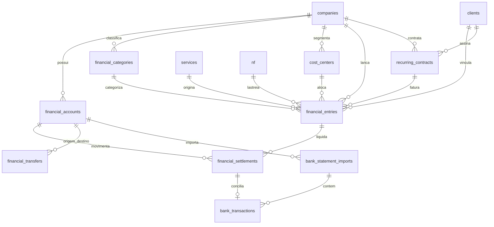
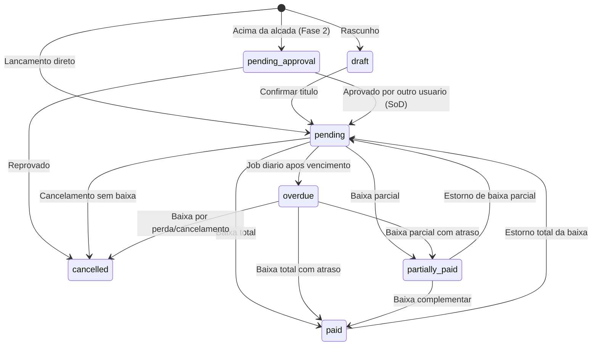

# Módulo Financeiro — Especificação Técnica e Arquitetura (PFM)

> **Documentos relacionados (leitura obrigatória):**
> - [SECURITY.md](./SECURITY.md) — Padrões obrigatórios OWASP aplicados à stack (em especial **§ 13 — Financeiro, Contabilidade, Pagamentos e Fiscal**)
> - [MODULO_CONTABILIDADE.md](./MODULO_CONTABILIDADE.md) — Plano de contas, partidas dobradas, regime de competência e ponte automática com este módulo
> - [IMPLEMENTACAO_NFSE_ADN.md](./IMPLEMENTACAO_NFSE_ADN.md) — Especificação futura de integração NFS-e Padrão Nacional
> - [PLANEJAMENTO_MULTI_TENANT_MOTHER.md](./PLANEJAMENTO_MULTI_TENANT_MOTHER.md) — Hierarquia Matriz/Filiais (`mother_id`) e escopo consolidado

**Versão:** 1.0 (`2026-11-26`)
**Stack alvo:** Bun 1.x + TypeScript 5.9 + Fastify v5 + Zod 4 + Drizzle ORM + PostgreSQL 16 + React 19 (Vite)

---

## 1. Objetivo, Posicionamento e Limitações Reais do PFM

O **Módulo Financeiro do PFM** tem como objetivo transformar o controle operacional já existente no sistema (**Empresas Matriz/Filial, Clientes, Serviços e Notas Fiscais em PDF**) em gestão financeira prática para **pequenas e médias empresas (PMEs) prestadoras de serviços e operações SaaS/recorrentes**, permitindo enxergar **quanto há para receber, quanto há para pagar, quanto efetivamente entrou/saiu do caixa e qual a saúde financeira por filial ou consolidada**.

Para construir um módulo sólido e juridicamente seguro, é fundamental registrar **o que o PFM entrega e o que ele NÃO faz** dentro das nossas limitações técnicas e regulatórias atuais:

### 1.1 Limitações Técnicas e de Infraestrutura
- **Container enxuto em VM única:** A API em produção roda em container único com `mem_limit: 512m` e `pids_limit: 256` em VM Oracle Cloud (`compose.production.yaml`), sem Redis, RabbitMQ, BullMQ ou cluster de workers dedicado.
- **Processamento síncrono/leve:** Importações de extratos (OFX/CSV), geração de relatórios e rotinas agendadas (como marcação de títulos vencidos) devem usar streaming ou lotes curtos no PostgreSQL e limites rígidos de payload (máx. 5 MB / limite de linhas por importação), evitando picos de memória.
- **Sem parsing pesado de OCR financeiro no servidor:** Diferente do extrator básico de texto em PDF (`pdfjs-dist` com limite de 20 páginas), o módulo financeiro não fará leitura por IA/OCR de boletos ou comprovantes em imagem na Fase 1/2; o registro será estruturado via formulário, vínculo com `services`/`nf`, arquivo OFX/CSV padronizado ou webhook de gateway.

### 1.2 Limitações Legais e Regulatórias (Banco Central / SFN / Fiscal)
- **O PFM NÃO é banco, instituição de pagamento (IP) nem PSP:** Conforme a legislação do Sistema Financeiro Nacional (SFN / Banco Central do Brasil — Leis nº 4.595/1964 e nº 12.865/2013), o PFM **não custodia recursos de terceiros**, não realiza liquidação bancária direta e não gera cobranças PIX/Boleto registradas por conta própria.
- **Integração indireta obrigatória para cobrança online:** Quando houver emissão de PIX dinâmico, boleto ou cartão (Fase 3), isso ocorrerá exclusivamente via **gateway/PSP regulado** (ex.: Asaas, Efí, Pagar.me ou Stripe) em nome da empresa cliente, com baixa confirmada **somente server-to-server** (API autenticada do provedor ou webhook com assinatura HMAC validada — nunca por retorno de tela do frontend).
- **Motor fiscal apenas estimativo até ADN:** Enquanto a integração descrita em `IMPLEMENTACAO_NFSE_ADN.md` não estiver ativa, cálculos de retenções (ISS, IRRF, CSRF) ou estimativas de impostos sobre faturamento têm caráter **gerencial/informativo**, devendo ser validados pelo contador responsável.
- **Separação Financeiro vs. Contábil:** Este módulo controla **liquidez e títulos** (Caixa, Contas a Pagar/Receber, Bancos, Inadimplência, Fluxo de Caixa). A escrituração em **partidas dobradas, balancete, DRE societária e fechamento de competência** pertence ao [MODULO_CONTABILIDADE.md](./MODULO_CONTABILIDADE.md).

---

## 2. Classificação das Referências Estudadas

Durante o levantamento teórico, foram analisadas referências de gestão financeira SaaS, legislação financeira e normas públicas/bancárias. Abaixo está a triagem explícita do que **entra** e do que **fica fora de escopo** no PFM:

| Fonte / Referência Consultada | Tema Principal | Aplicação no PFM |
| --- | --- | --- |
| [Stripe — SaaS Accounting 101](https://stripe.com/br/resources/more/saas-accounting-101) | Caixa vs. competência em SaaS, receita diferida, cobranças recorrentes e taxas | **Aplicável:** Base conceitual para separar data de competência, data de vencimento, data de baixa e taxa de gateway; modelo de assinatura (Fase 3). |
| [Digital Manager Guru — Gestão Financeira SaaS](https://digitalmanager.guru/blog/gestao-financeira-saas) | Métricas recorrentes (MRR, ARR, Churn, LTV, CAC), fluxo de caixa e inadimplência | **Aplicável:** Definição dos KPIs gerenciais do dashboard financeiro (Seção 6). |
| [NetSuite — SaaS Accounting](https://www.netsuite.com/portal/resource/articles/accounting/saas-accounting.shtml) | Ciclo pedido → faturamento → recebimento → reconhecimento de receita | **Aplicável:** Integração `services` → `nf` → `financial_entries` → `financial_settlements` → ponte contábil. |
| [G-Squared CFO — SaaS Business Accounting](http://gsquaredcfo.com/the-ultimate-guide-to-saas-business-accounting) | Estrutura de DRE SaaS (COGS/CSP, margem bruta, OpEx, Burn Rate e Runway) | **Aplicável:** Categorização inicial do plano gerencial (Custos Diretos de Serviço vs. Despesas Operacionais) e cálculo de Burn Rate / Runway. |
| [CCM Tecnologia — SaaS nos negócios](https://blog.ccmtecnologia.com.br/post/software-as-a-service-entenda-mais-sobre-o-uso-nos-negocios) | Modelo de assinatura e previsibilidade de receita B2B | **Aplicável:** Suporte a contratos recorrentes com faturamento mensal/anual e projeção de fluxo de caixa. |
| [Fortes Tecnologia — Legislação Financeira](https://blog.fortestecnologia.com.br/post/legislacao-financeira) | Boas práticas de conformidade financeira empresarial no Brasil | **Aplicável:** Rastreabilidade de recebimentos/pagamentos, guarda documental e aderência fiscal. |
| [ContabNet — Contabilidade para empresa SaaS](https://contabnet.com.br/blog/contabilidade-para-empresa-saas/) & [Moreira Mendes — SaaS e Contabilidade Estratégica](https://moreiramendes.com.br/blog/saas-e-tecnologia-desmistificando-a-contabilidade-estrategica) | Regime tributário, Fator R, pró-labore, fluxo de caixa e planejamento para empresas de tecnologia | **Aplicável:** Separação de despesas com pessoal/pró-labore no plano de categorias para alimentar indicadores gerenciais e exportação contábil. |
| [Banco Central — Leis do SFN](https://www.bcb.gov.br/pre/leisedecretos/port/leissfn.asp?frame=1) | Regulação de bancos, instituições financeiras e sistema de pagamentos | **Limite regulatório (não implementado):** Define por que o PFM **não** atua como instituição financeira nem custodia valores; apenas registra saldos e integra APIs/extratos de bancos regulados. |
| [Portal do Investidor (CVM) — Leis do Mercado de Capitais](https://www.gov.br/investidor/pt-br/investir/como-investir/conheca-o-mercado-de-capitais/principais-leis-do-mercado-de-capitais) | Mercado de valores mobiliários, CVM, S.A. de capital aberto | **Fora de escopo:** O público-alvo do PFM são PMEs/prestadores de serviço, não companhias abertas nem distribuidoras de valores. |
| Direito Financeiro Público ([Trilhante](https://trilhante.com.br/curso/fontes-e-normas-gerais-do-direito-financeiro/aula/fontes-do-direito-financeiro-2), [Direito Legal](https://direito.legal/fontes-do-direito-financeiro), [PUC-SP](https://enciclopediajuridica.pucsp.br/verbetes/normas-gerais-de-direito-financeiro/), [Câmara dos Deputados](https://www2.camara.leg.br/orcamento-da-uniao/cidadao/entenda/cursopo/principios), [Jusbrasil](https://www.jusbrasil.com.br/artigos/direito-financeiro-atividade-do-estado-no-dominio-organizacional/1860256703), [Resumo Direito Financeiro](https://www.kufunda.net/publicdocs/Resumo-Esquematizado-Direito-Financeiro-demonstrativo-1.pdf)) | Orçamento público (PPA, LDO, LOA), Lei nº 4.320/1964, Lei de Responsabilidade Fiscal (LC 101/2000), dívida pública e precatórios | **Fora de escopo:** Trata da atividade financeira **do Estado** (ente público), com regras próprias de empenho/liquidação pública inaplicáveis à gestão financeira privada de PMEs. |
| Guias de finanças pessoais / princípios comportamentais | Orçamento doméstico pessoal | **Fora de escopo:** O PFM é um ERP/gestão corporativa multi-tenant vinculada a CNPJ (`companies`); receitas e despesas pessoais dos sócios não devem se misturar ao caixa da empresa (Princípio Contábil da Entidade). |

---

## 3. Integração com o Schema e RBAC Atuais do PFM

O schema atual (`src/database/schema/schema.ts`) já possui a estrutura base de empresas, clientes, serviços e notas fiscais. O Módulo Financeiro deve se acoplar a essas entidades **sem alterar fluxos legados que já funcionam em produção**:

### 3.1 Pontos de Integração no Schema Existente
- **`companies` (`id`, `mother_id`, `cnpj`, `active`):** Todo registro financeiro (`financial_accounts`, `financial_categories`, `cost_centers`, `financial_entries`, `financial_settlements`, `bank_transactions`, `recurring_contracts`) terá coluna obrigatória `company_id` indexada e validada contra `request.tenant.accessibleCompanyIds`.
  - **Visão Matriz vs. Consolidada (`x-company-id` e `x-view-scope=consolidated`):** Já suportada em `src/middlewares/auth.middleware.ts`. Na visão consolidada, receitas e despesas entre empresas do mesmo grupo (`is_intercompany = true`) devem poder ser **filtradas/eliminadas** dos totalizadores gerenciais para não inflar artificialmente o faturamento do grupo.
- **`clients` (`id`, `company_id`, `cnpj`, `cpf`, `anonymized_at`):** Títulos a Receber referenciam `client_id` (opcionalmente também para Títulos a Pagar caso haja reembolso ou fornecedor cadastrado no futuro). Títulos vinculados a clientes que passaram por anonimização LGPD (`anonymized_at IS NOT NULL`) **preservam valores, datas e vínculo fiscal/título** pelo prazo legal de 5 anos (Art. 16, I da LGPD).
- **`services` (`id`, `company_id`, `price`, `initial_date`, `finish_date`, `client_id`, `status_service_id`):** Um serviço criado ou concluído pode gerar automaticamente (ou sob confirmação do usuário) um ou mais títulos em `financial_entries` (`origin_type = 'service'`, `service_id`), convertendo `services.price` (`numeric(10, 2)`) no servidor para centavos (`BigInt` / `bigint`).
- **`nf` (`id`, `company_id`, `total_value`, `emission_date`, `cancel_date`, `services_id`, `active`):** Quando uma Nota Fiscal é vinculada/emitida para um serviço, o título a receber associado pode referenciar `nf_id` e ter seu valor conciliado com `nf.total_value`. Caso a NF seja cancelada (`cancel_date` ou `active = false`), o sistema deve sinalizar títulos em aberto vinculados para revisão/cancelamento (sem apagar baixas já liquidadas no banco — estorno se aplicável).

> [!IMPORTANT]
> **Por que NÃO reutilizar a tabela `movimentation` existente:**
> No schema atual (`src/database/schema/schema.ts`), a tabela `movimentation` (`name`, `nf_id`, `destination_user_id`, `destination_client_id`, `justify`) rastreia a **movimentação logística/documental de Notas Fiscais** entre usuários e clientes, inclusive sendo referenciada por `nf.movimentation_id`. Sobrecarregar `movimentation` com baixa bancária, parcelas, juros e conciliação quebraria o domínio atual e violaria separação de responsabilidades. O Módulo Financeiro usará **tabelas próprias**, mantendo `movimentation` intacta para seu propósito original.

### 3.2 Matriz de Permissões (RBAC) por Papel Existente

Os papéis ativos em `src/database/seed.ts` são: `administrator`, `company_admin`, `manager`, `finance`, `observer` e `colaborator`.

| Papel (`roles.name`) | Contas Bancárias / Categorias | Contas a Pagar e Receber (Criar/Editar) | Baixar / Estornar Pagamento | Aprovar Pagamento (*Maker-Checker*, Fase 2) | Relatórios (Fluxo de Caixa, DRE, Aging) | Exportação CSV/OFX | Escopo Consolidado |
| --- | --- | --- | --- | --- | --- | --- | --- |
| `company_admin` | Completo | Completo | Completo (respeitando SoD se ativo) | Sim | Sim | Sim | Sim (se Matriz) |
| `finance` | Completo | Completo | Completo (até alçada ou requer aprovação) | Sim (se não for o criador) | Sim | Sim | Sim (se autorizado na Matriz) |
| `manager` | Leitura | Leitura / Solicitação (opcional) | Não | Sim (opcional por alçada) | Sim | Leitura/Limitado | Sim (se autorizado) |
| `observer` | Leitura | Somente leitura | Não | Não | Somente leitura | Não (ou mascarado) | Sim (se Matriz) |
| `colaborator` | **Bloqueado (403)** | **Bloqueado (403)** | **Bloqueado (403)** | **Bloqueado (403)** | **Bloqueado (403)** | **Bloqueado (403)** | **Bloqueado** |
| `administrator` | Gestão SaaS / suporte auditado | Apenas suporte / admin dados | Bloqueado por padrão (segregação tenant) | Não | Somente leitura agregada (se aplicável) | Não | N/A |

**Regra sagrada do `colaborator`:** Conforme `SECURITY.md` § 3, usuários com papel `colaborator` **jamais** podem acessar rotas de `/finance/*`, saldos bancários, faturamento ou títulos da empresa (acesso restrito exclusivamente aos seus serviços vinculados em `bundled`).

---

## 4. Modelagem de Dados Proposta (PostgreSQL + Drizzle ORM)

Para atender ao **§ 13.1 de `SECURITY.md`** (zero aritmética de ponto flutuante binário `Number`), **todos os valores monetários das novas tabelas devem ser persistidos em centavos inteiros (`bigint` no PostgreSQL, `bigint({ mode: "bigint" })` ou `bigint({ mode: "number" })` apenas após validação de range seguro, preferindo `BigInt` no domínio financeiro)**, além de preservar precisão para alíquotas em pontos-base (`integer`, ex.: `250` = `2,50%`).

### 4.1 Tabelas da Fase 1 (MVP Enxuto)

1. **`financial_accounts`** (Contas financeiras / caixas da empresa)
   - `id` (UUID v7 PK), `company_id` (FK `companies.id` NOT NULL)
   - `name` (text, ex.: `"Conta Cora Matriz"`, `"Caixa Físico"`, `"Carteira Asaas"`)
   - `type` (`'checking' | 'savings' | 'cash' | 'gateway' | 'credit_card'`)
   - `bank_code` (varchar(10) nullable), `agency_masked` (text nullable), `account_masked` (text nullable) — **nunca** armazenar credenciais bancárias em texto claro
   - `initial_balance_cents` (`bigint` NOT NULL default `0`), `initial_balance_date` (`date` NOT NULL)
   - `current_balance_cents` (`bigint` NOT NULL default `0`) — cache atualizado exclusivamente dentro de `db.transaction` com `SELECT ... FOR UPDATE` junto aos settlements/transfers (reconciliável pela soma histórica)
   - `active` (`boolean` NOT NULL default `true`), `created_at`, `updated_at`

2. **`financial_categories`** (Plano Gerencial — Caixa e DRE Gerencial)
   - `id` (UUID v7 PK), `company_id` (FK `companies.id` NOT NULL)
   - `parent_id` (UUID self-reference nullable — permite agrupamento em 2–3 níveis)
   - `code` (varchar(30) NOT NULL, único por `company_id`, ex.: `"1.01"`, `"2.01"`)
   - `name` (text NOT NULL)
   - `kind` (`'revenue' | 'deduction' | 'direct_cost' | 'operating_expense' | 'financial_result' | 'transfer'`)
   - `dre_group` (`'gross_revenue' | 'taxes_and_deductions' | 'cogs' | 'sales_marketing' | 'ga_admin' | 'payroll' | 'financial_income' | 'financial_expense' | 'non_operational' | null`)
   - `is_system` (`boolean` default `false` — seed inicial protegido contra exclusão)
   - `active` (`boolean` default `true`), `created_at`, `updated_at`

3. **`cost_centers`** (Opcional na Fase 1, habilita visão por projeto/área/filial)
   - `id` (UUID v7 PK), `company_id` (FK `companies.id` NOT NULL), `code` (varchar(20)), `name` (text NOT NULL), `active` (`boolean` default `true`), `created_at`, `updated_at`

4. **`financial_entries`** (Títulos de Contas a Pagar e Contas a Receber)
   - `id` (UUID v7 PK), `company_id` (FK `companies.id` NOT NULL)
   - `entry_type` (`'receivable' | 'payable'` NOT NULL)
   - `status` (`'draft' | 'pending_approval' | 'pending' | 'partially_paid' | 'paid' | 'overdue' | 'cancelled'` NOT NULL)
   - `description` (text NOT NULL), `document_number` (text nullable), `notes` (text nullable)
   - **Origem e Vínculos:** `client_id` (FK `clients.id` nullable), `counterparty_name` (text nullable — para fornecedores até eventual cadastro dedicado de fornecedores), `counterparty_document` (text nullable — CNPJ/CPF validado), `service_id` (FK `services.id` nullable), `nf_id` (FK `nf.id` nullable), `recurring_contract_id` (UUID nullable — Fase 3), `category_id` (FK `financial_categories.id` NOT NULL), `cost_center_id` (FK `cost_centers.id` nullable)
   - **Datas-chave (Competência vs. Caixa):**
     - `competence_date` (`date` NOT NULL — data do fato gerador para DRE Gerencial e Contabilidade)
     - `issue_date` (`date` NOT NULL)
     - `due_date` (`date` NOT NULL)
     - `paid_at` (`timestamp` nullable — preenchido quando `status = 'paid'`)
   - **Valores em centavos (`bigint`, sempre `>= 0`):**
     - `original_amount_cents` (`bigint` NOT NULL, `> 0`)
     - `discount_cents` (`bigint` NOT NULL default `0`)
     - `interest_cents` (`bigint` NOT NULL default `0`)
     - `fine_cents` (`bigint` NOT NULL default `0`)
     - `net_amount_cents` (`bigint` NOT NULL — calculado **exclusivamente no servidor**)
     - `settled_amount_cents` (`bigint` NOT NULL default `0`)
   - **Parcelamento e Intercompany:** `installment_number` (`integer` default `1`), `total_installments` (`integer` default `1`), `installment_group_id` (UUID nullable), `is_intercompany` (`boolean` NOT NULL default `false`), `counterparty_company_id` (FK `companies.id` nullable)
   - **Auditoria e Idempotência:** `created_by` (FK `users.id` NOT NULL), `approved_by` (FK `users.id` nullable), `approved_at` (`timestamp` nullable), `cancelled_by` (FK `users.id` nullable), `cancel_reason` (text nullable), `idempotency_key` (varchar(128) nullable), `created_at`, `updated_at`
   - **Índices:** `(company_id, entry_type, status, due_date)`, `(company_id, competence_date)`, `(service_id)`, `(nf_id)`, único `(company_id, idempotency_key)` quando não nulo.

5. **`financial_settlements`** (Baixas / Pagamentos / Recebimentos — *Append-Only*)
   - `id` (UUID v7 PK), `company_id` (FK `companies.id` NOT NULL)
   - `entry_id` (FK `financial_entries.id` NOT NULL)
   - `account_id` (FK `financial_accounts.id` NOT NULL)
   - `settlement_type` (`'payment' | 'reversal'` NOT NULL)
   - `reversed_settlement_id` (UUID self-reference nullable — obrigatório quando `settlement_type = 'reversal'`)
   - `payment_method` (`'pix' | 'boleto' | 'bank_transfer' | 'credit_card' | 'debit_card' | 'cash' | 'other'` NOT NULL)
   - `settled_at` (`timestamp` NOT NULL)
   - **Valores em centavos (`bigint`):** `principal_cents`, `interest_cents`, `fine_cents`, `discount_cents`, `gateway_fee_cents`, `total_settled_cents` (`> 0`, recalculado no servidor)
   - `external_provider` (text nullable), `external_tx_id` (text nullable), `idempotency_key` (varchar(128) NOT NULL)
   - `created_by` (FK `users.id` NOT NULL), `notes` (text nullable), `created_at` (`timestamp` NOT NULL default `now()`)
   - **Regra de imutabilidade:** Linhas em `financial_settlements` **nunca** sofrem `UPDATE` nem `DELETE`. Erros de baixa são corrigidos inserindo uma linha `settlement_type = 'reversal'` vinculada à original, recalculando o saldo da conta e o status do título na mesma transação.

### 4.2 Tabelas da Fase 2 (Transferências e Conciliação Bancária OFX/CSV)

6. **`financial_transfers`** (Transferências entre contas da própria empresa ou Matriz ↔ Filial)
   - `id` (UUID v7 PK), `company_id` (FK `companies.id` — empresa iniciadora)
   - `source_account_id` (FK `financial_accounts.id`), `destination_account_id` (FK `financial_accounts.id` — `!= source_account_id`)
   - `amount_cents` (`bigint` `> 0`), `transfer_date` (`date`), `is_intercompany` (`boolean`), `description` (text)
   - `status` (`'completed' | 'reversed'`), `reversed_transfer_id` (UUID nullable), `idempotency_key` (varchar(128) NOT NULL), `created_by`, `created_at`

7. **`bank_statement_imports`** e **`bank_transactions`** (Conciliação sem API Open Finance paga)
   - `bank_statement_imports`: `id`, `company_id`, `account_id`, `file_format` (`'ofx' | 'csv'`), `file_sha256` (char(64) — impede reimportação acidental do mesmo arquivo), `period_start`, `period_end`, `imported_count`, `created_by`, `created_at`.
   - `bank_transactions`: `id`, `company_id`, `account_id`, `import_id`, `external_fitid` (text NOT NULL — ou hash determinístico dos campos se CSV sem FITID), `posted_date` (`date`), `direction` (`'credit' | 'debit'`), `amount_cents` (`bigint` `> 0`), `memo` (text), `reconciliation_status` (`'unmatched' | 'matched' | 'ignored'`), `matched_settlement_id` (FK `financial_settlements.id` nullable), `matched_transfer_id` (FK `financial_transfers.id` nullable).
   - **Índice único anti-duplicidade:** `UNIQUE (account_id, external_fitid)` garante que importar dois extratos com datas sobrepostas nunca duplique movimentações bancárias.

### 4.3 Tabelas da Fase 3 (Recorrência SaaS / Assinaturas e Webhooks PSP)

8. **`recurring_contracts`** (Contratos recorrentes para cálculo nativo de MRR/ARR/Churn)
   - `id` (UUID v7 PK), `company_id`, `client_id` (FK `clients.id`), `service_id` (FK `services.id` nullable), `category_id` (FK `financial_categories.id`)
   - `plan_name` (text), `billing_cycle` (`'monthly' | 'quarterly' | 'semiannual' | 'annual'`), `amount_cents` (`bigint` `> 0`), `mrr_equivalent_cents` (`bigint` — calculado no servidor: ex. plano anual / 12)
   - `start_date` (`date`), `next_billing_date` (`date`), `end_date` (`date` nullable), `status` (`'active' | 'paused' | 'cancelled'`), `cancelled_at` (`timestamp` nullable), `cancellation_reason` (text nullable)

9. **`payment_webhook_events`** (Tabela de anti-replay para PSPs — `SECURITY.md` § 13.3)
   - `id` (UUID v7 PK), `provider` (text NOT NULL), `event_id` (text NOT NULL), `company_id` (FK `companies.id` nullable), `payload_sha256` (char(64) NOT NULL), `status` (`'received' | 'processed' | 'ignored' | 'failed'`), `received_at`, `processed_at`.
   - **Índice único:** `UNIQUE (provider, event_id)`.

---

## 5. Fluxos Operacionais e Regras de Negócio

### 5.1 Máquina de Estados de `financial_entries`

- **Proteção contra corrida (Race Condition):** Toda baixa/estorno em `/finance/entries/:id/settle` executa dentro de `db.transaction`:
  1. `SELECT ... FROM financial_entries WHERE id = $1 AND company_id IN (...) FOR UPDATE`
  2. `SELECT ... FROM financial_accounts WHERE id = $accountId AND company_id = entry.company_id FOR UPDATE`
  3. Valida status permitido (`pending | partially_paid | overdue`), calcula saldo restante (`remaining = net_amount_cents - settled_amount_cents`) e rejeita baixa maior que o saldo restante (salvo juros/multa informados explicitamente e recalculados no servidor).
  4. Insere em `financial_settlements`, atualiza `settled_amount_cents` e `status` do título, e atualiza `financial_accounts.current_balance_cents`.
  5. Dispara (quando o Módulo Contábil estiver ativo) o lançamento contábil correspondente dentro da **mesma transação**, garantindo atomicidade total entre Financeiro e Contabilidade.

### 5.2 Integração Pragmática com `services` e `nf`
- **Sem acoplamento rígido:** O usuário pode criar um título financeiro livremente (ex.: conta de energia, folha, internet, pró-labore) **ou** gerar um título a receber a partir de um registro de `services` / `nf`.
- **Conferência NF ↔ Título:** Ao vincular `nf_id`, o backend valida no mesmo `company_id` que a NF está ativa e compara `nf.total_value` com `original_amount_cents`, alertando divergência (ex.: retenção de ISS na fonte explicando valor líquido menor que o bruto da NF).

### 5.3 Conciliação Bancária Pragmática (Sem Custo de Open Finance)
- Open Finance / Pluggy / Belvo envolve custos mensais por conexão e homologação regulatória. Na realidade atual do PFM, a conciliação **OFX + CSV** (disponível gratuitamente em todos os bancos brasileiros: Banco do Brasil, Itaú, Bradesco, Santander, Caixa, Nubank PJ, Inter PJ, Cora, Sicoob) resolve 95% da operação a custo zero.
- **Fluxo:** Upload do arquivo `.ofx` ou `.csv` (máx. 2 MB) → parser seguro sem entidades externas/XXE → deduplicação via `(account_id, external_fitid)` → sugestão automática por match exato de `amount_cents` + janela de `±3 dias` da `settled_at` → confirmação humana (ou criação rápida de lançamento faltante, como tarifa bancária).

---

## 6. Relatórios Gerenciais e Indicadores (PME + SaaS)

| Relatório / Indicador | Regime | Fórmula / Fonte de Dados no PFM | Restrições / Regras |
| --- | --- | --- | --- |
| **Fluxo de Caixa Realizado (DFC Direta)** | Caixa | Soma de `financial_settlements` (liquidadas) + `financial_transfers` agrupada por `financial_categories` e dia/mês | Ignora transferências internas na visão da empresa e `is_intercompany = true` na visão consolidada |
| **Fluxo de Caixa Projetado (30/60/90d)** | Caixa previsto | Saldo atual das `financial_accounts` + `financial_entries` abertas (`pending`, `partially_paid`, `overdue`) por `due_date` + previsões de `recurring_contracts` (Fase 3) | Exibe separadamente títulos vencidos (`overdue`) para não mascarar caixa disponível real |
| **Contas a Pagar / Receber e Aging** | Liquidez | Títulos em aberto agrupados em faixas: a vencer, `1–15d`, `16–30d`, `31–60d`, `> 60d` de atraso | Taxa de inadimplência = vencidos > X dias / total a receber no período |
| **DRE Gerencial** | Competência (principal) e Caixa (comparativo) | `financial_entries` (excluindo canceladas) agrupadas por `dre_group` usando `competence_date` | Aviso explícito de caráter **gerencial**; DRE contábil oficial reside no Módulo Contábil |
| **MRR e ARR (Fase 3)** | Competência recorrente | `SUM(mrr_equivalent_cents)` dos `recurring_contracts` com `status = 'active'` (`ARR = MRR * 12`) | Não somar taxas de setup / projetos pontuais (`services` avulsos) no MRR |
| **Churn Financeiro (Logo e Revenue Churn)** | Mensal | Receita recorrente cancelada no mês / MRR do início do mês (`Revenue Churn`) e clientes cancelados / base ativa (`Logo Churn`) | Calcula também *Net Revenue Retention* quando houver expansão de planos |
| **Burn Rate e Runway** | Caixa | `Burn Mensal = Saídas Operacionais - Entradas` (média dos últimos 3 meses); `Runway (meses) = Caixa Livre / Burn Mensal` (se negativo) | Exibido apenas quando o resultado líquido médio for negativo |

---

## 7. Contratos de API (Fastify + Zod) e Segurança Obrigatória

### 7.1 Endpoints Planejados (`/api/private/finance/*` ou `/finance/*`)

| Método e Rota | Descrição | Papéis Permitidos | Regras Específicas (`SECURITY.md`) |
| --- | --- | --- | --- |
| `GET/POST/PATCH /finance/accounts` | CRUD e saldo de contas financeiras | Leitura: `company_admin, finance, manager, observer` Escrita: `company_admin, finance` | Filtrado por `accessibleCompanyIds`; nunca retornar credenciais |
| `GET/POST/PATCH /finance/categories` | Plano gerencial de categorias | Idem acima | Proteger categorias `is_system = true` contra remoção |
| `GET/POST/PATCH /finance/entries` | Listar, criar e editar títulos (Pagar/Receber) | Idem acima | `Idempotency-Key` no `POST`; bloqueia alteração de valor após baixa parcial/total; recálculo server-side |
| `POST /finance/entries/:id/approve` | Aprovar título em `pending_approval` (Fase 2) | `company_admin, finance, manager` | **SoD obrigatório:** `request.user.id !== entry.createdBy` |
| `POST /finance/entries/:id/cancel` | Cancelar título em aberto | `company_admin, finance` | Exige motivo; proibido se houver saldo já liquidado não estornado |
| `POST /finance/entries/:id/settle` | Registrar baixa total ou parcial | `company_admin, finance` | `Idempotency-Key` + `db.transaction` + `FOR UPDATE` + recálculo de juros/multa/desconto |
| `POST /finance/settlements/:id/reverse` | Estornar baixa lançada erroneamente | `company_admin, finance` | `Idempotency-Key` + gera registro `reversal` *append-only* (nunca `DELETE`) |
| `POST /finance/transfers` | Transferência entre contas (inclui Matriz ↔ Filial) | `company_admin, finance` | Valida acesso às duas empresas envolvidas e marca `is_intercompany` automaticamente |
| `GET /finance/reports/cashflow` | Fluxo de caixa realizado e projetado | `company_admin, finance, manager, observer` | Limite máximo de janela (ex.: 366 dias); elimina *intercompany* em `consolidated` |
| `GET /finance/reports/aging` | Aging de inadimplência e contas a pagar | Idem acima | Paginação obrigatória em listas detalhadas |
| `GET /finance/reports/dre-managerial` | DRE gerencial mensal/anual | Idem acima | Filtra por `competence_date` |
| `GET /finance/reports/export` | Exportação CSV/XLSX sanitizada | `company_admin, finance` | Neutralização anti-formula injection (`=`, `+`, `-`, `@`, `\t`, `\r`) + audit log |
| `POST /finance/reconciliation/import` | Importar extrato OFX/CSV (Fase 2) | `company_admin, finance` | Limite 2 MB; parser sem DTD/XXE; deduplicação por `(account_id, external_fitid)` |
| `POST /public/webhooks/payments/:provider` | Receber confirmações do PSP (Fase 3) | Público assinado (HMAC) | Raw body + `crypto.timingSafeEqual` + timestamp ±5 min + `UNIQUE (provider, event_id)` |

### 7.2 Checklist de Segurança Obrigatório (`SECURITY.md` § 13)
1. **Aritmética exata em centavos:** Zero uso de `Number` em operações decimais de moeda; valores trafegados na API como inteiro em centavos (`z.number().int().nonnegative()`) ou string decimal exata convertida via parser sem float para `BigInt`.
2. **Idempotência composta:** Índice único `(company_id, endpoint, idempotency_key)` + comparação de hash SHA-256 do payload (`409 Conflict` se mesma chave for reusada com payload diferente).
3. **Atualização do Pino `redact` (`src/config/logger.ts`):** Antes de ativar qualquer rota financeira em produção, adicionar `pixKey`, `bankAccount`, `agency`, `accountNumber`, `webhookSecret`, `clientSecret`, `accessToken`, `refreshToken` em `sharedRedact`.
4. **Sanitização de exportações:** Prefixo `'` em qualquer célula exportada para CSV/XLSX cujo texto (após trim esquerdo) inicie com `=`, `+`, `-`, `@`, `\t` ou `\r`.
5. **Auditoria (`audit_logs`) e Retenção LGPD:** Toda criação/baixa/estorno/cancelamento/exportação grava `audit_logs` com `actorId`, `companyId`, `action`, `targetId` e `requestId`. Registros vinculados a obrigações fiscais/financeiras seguem guarda mínima de **5 anos** (Art. 16, I da LGPD).
6. **Segregação de Funções (*Maker-Checker*) e Reautenticação:** Na Fase 2+, pagamentos acima de alçada configurada na empresa exigem aprovação de um segundo usuário (`approvedBy !== createdBy`) e confirmação de senha/OTP para alterações de dados bancários de favorecido ou conta.

---

## 8. Roadmap Faseado (Viável para o PFM)

| Fase | Escopo Entregue | Dependências / Riscos Mitigados |
| --- | --- | --- |
| **Fase 1 — MVP Financeiro Operacional** | `financial_accounts`, `financial_categories` (seed padrão PME/SaaS), `cost_centers`, `financial_entries` (Pagar/Receber), `financial_settlements` (*append-only* + estorno), geração opcional a partir de `services`/`nf`, Fluxo de Caixa Realizado/Projetado, Aging de atrasos e exportação CSV sanitizada. | Roda 100% na VM atual de 512 MB; sem dependências externas pagas; baixa complexidade operacional. |
| **Fase 2 — Conciliação, Transferências e Governança** | `financial_transfers` (com tratamento *intercompany* Matriz/Filial), importação OFX/CSV e conciliação bancária assistida, DRE Gerencial por competência, job leve diário para marcação de `overdue`, alçadas *Maker-Checker* e ponte automática completa com `MODULO_CONTABILIDADE.md`. | Elimina digitação manual repetitiva de extratos sem pagar provedores Open Finance; garante integridade contábil. |
| **Fase 3 — SaaS, Recorrência e Gateway/PSP** | `recurring_contracts`, dashboard nativo de MRR / ARR / Churn / Burn Rate / Runway, integração com PSP regulado (PIX/Boleto via webhook HMAC + anti-replay) e integração direta com emissão NFS-e ADN (`IMPLEMENTACAO_NFSE_ADN.md`). | Depende de contrato comercial da empresa usuária com PSP regulado e certificado digital A1 (para ADN). |
